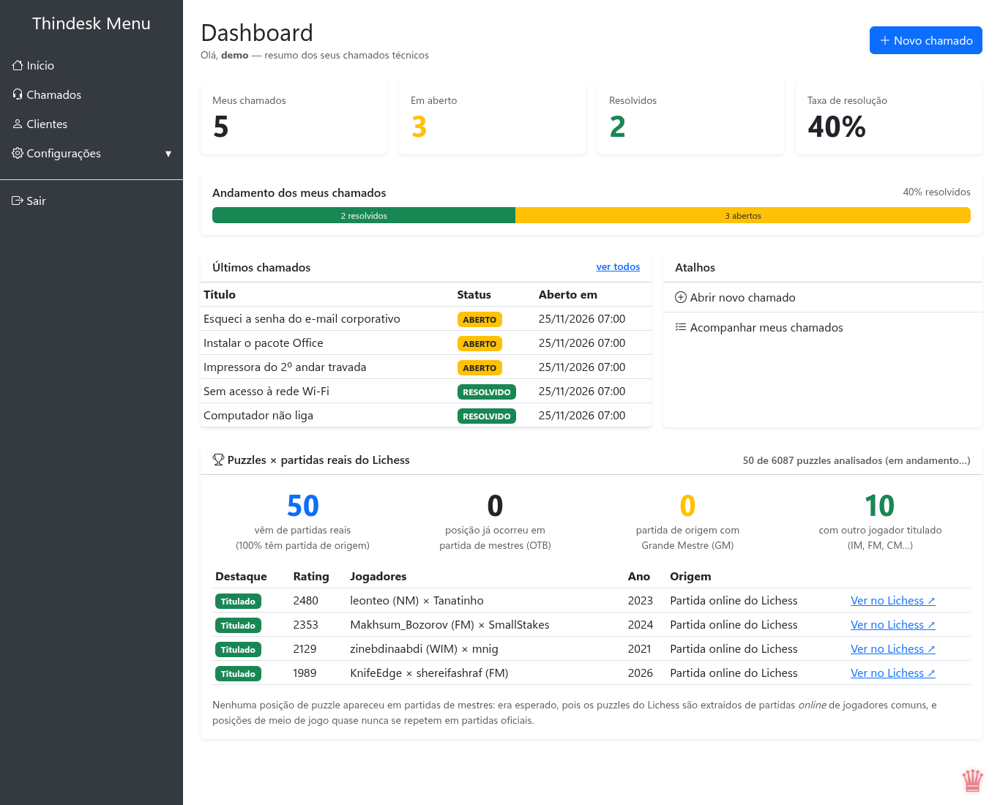

# Thindesk — Sistema de Controle de Chamados Técnicos

**Aluno:** Miguel Santana da Costa
**Atividade:** Software corporativo — controle de chamados técnicos (Thindesk)
**Versão entregue:** `1.0.0-beta.4`

---

## 1. Links da entrega

| Item | Link |
| ---- | ---- |
| **Aplicação no ar (deploy)** | **https://thindesk-santana.duckdns.org/** |
| Repositório GitHub — Thindesk (aplicação web, login e dashboard) | https://github.com/MiguelSantanaDaCosta/Sistema-de-Login-Seguro |
| Repositório GitHub — Microserviço de chamados (`ms-chamados`) | https://github.com/MiguelSantanaDaCosta/-Microservi-o-de-Chamados-T-cnicos- |

O `README.md` de cada repositório traz a documentação técnica completa (versionamento, dashboard, deploy, configuração).

### Credenciais de exemplo (qualquer pessoa pode entrar)

| Perfil | Usuário | Senha | Como entra |
| ------ | ------- | ----- | ---------- |
| Usuário comum | `demo` | `demo1234` | Somente usuário e senha |
| Técnico | `demo-tecnico` | `tecnico123` | Somente usuário e senha (vê a fila técnica e resolve chamados) |
| Administrador | `demo2` | `demo2-1234` | Usuário e senha + **puzzle de xadrez** de nível admin (não envia email) |

As contas demo não estão fixas no código: um administrador as gerencia na tela **Contas demo** do sistema.

---

## 2. Correspondência com os critérios da atividade

| Critério | Onde está | Status |
| -------- | --------- | ------ |
| Link do GitHub com a aplicação de controle de chamados funcional | Seção 1 (dois repositórios públicos) | ✅ |
| Semântica de versionamento no README | Seção 3 deste documento e seção **"Versionamento"** do `README.md` | ✅ |
| Print de uma tela de dashboard (compatível com o projeto do `.zip`) | Seção 4 deste documento e seção **"Dashboard"** do `README.md` | ✅ |
| Deploy funcionando, com login por qualquer pessoa e credencial de exemplo | Seção 1 e seção 5 | ✅ |

---

## 3. Versionamento

**Versão atual: `1.0.0-beta.4`**

O projeto segue o [Versionamento Semântico 2.0.0](https://semver.org/lang/pt-BR/), no formato:

```
MAJOR.MINOR.PATCH[-PRÉ-RELEASE]
```

| Parte | Quando incrementar | Exemplo |
| ----- | ------------------ | ------- |
| `MAJOR` | Mudança incompatível (ex.: troca do esquema de autenticação ou das coleções do banco) | `1.0.0` → `2.0.0` |
| `MINOR` | Nova funcionalidade compatível (ex.: novo módulo ou tela) | `1.0.0` → `1.1.0` |
| `PATCH` | Correção de bug compatível | `1.0.0` → `1.0.1` |
| `-alpha` / `-beta` / `-rc.N` | Pré-release: `alpha` = em desenvolvimento, `beta` = funcional e em testes, `rc` = candidata a lançamento | `1.0.0-beta` → `1.0.0-rc.1` → `1.0.0` |

A versão é declarada no `pom.xml`, aparece na barra lateral da aplicação (`Thindesk v1.0.0-beta`) e é registrada no `CHANGELOG.md`. Cada lançamento é uma **tag Git anotada** publicada como **Release** no GitHub:

- Thindesk: https://github.com/MiguelSantanaDaCosta/Sistema-de-Login-Seguro/releases
- Microserviço: https://github.com/MiguelSantanaDaCosta/-Microservi-o-de-Chamados-T-cnicos-/releases

As notas de cada versão estão em `docs/releases/` e o passo a passo de publicação em `docs/RELEASES.md`.

| Versão | Descrição |
| ------ | --------- |
| `1.0.0-alpha` | Login seguro (JWT + BCrypt), perfis e cadastro com confirmação por email |
| `1.0.0-beta` | Integração com o microserviço de chamados, telas de chamados, dashboard, perfis por dificuldade de puzzle, proteção anti-bot e deploy com HTTPS |
| `1.0.0-beta.2` | Hierarquia única de papéis (Thindesk e microserviço alinhados) e contas demo por perfil gerenciadas por administradores |
| `1.0.0-beta.3` | Desafios de promoção (cavalo verde → Técnico, torre azul → Administrador) e nome de usuário com acentos |
| `1.0.0-beta.4` | Esqueci minha senha, botão de olho nas senhas e envio de email que não finge sucesso |

---

## 4. Dashboard

Tela inicial do sistema (`/`), exibida após o login. Usa o mesmo layout (barra lateral + Bootstrap) do projeto de base, substituindo a página de boas-vindas.



O dashboard mostra:

- **Indicadores:** total de chamados do usuário, em aberto, resolvidos e taxa de resolução.
- **Barra de andamento** entre resolvidos e abertos.
- **Últimos chamados** com status e data de abertura.
- **Fila da equipe** (apenas `TECNICO` e `ADMIN`): chamados abertos de todos os usuários, do mais antigo ao mais novo.
- **Puzzles × partidas reais do Lichess:** cruza uma amostra dos puzzles de xadrez do sistema com dados públicos do Lichess, mostrando a partida de origem (jogadores, ano, link para ver no Lichess).

Os dados dos chamados vêm do microserviço `ms-chamados`.

---

## 5. Como avaliar o sistema (roteiro de teste)

1. Acesse **https://thindesk-santana.duckdns.org/** (o HTTP redireciona para HTTPS).
2. Entre com **`demo` / `demo1234`** → o sistema abre o **dashboard**.
3. Clique em **Novo chamado**, preencha título e descrição e salve. O chamado aparece em **Chamados** e no dashboard com status `ABERTO`.
4. Para ver o **fluxo do técnico** (fila e resolução de chamados): saia e entre com **`demo-tecnico` / `tecnico123`** (só usuário e senha).
5. No menu, abra **Fila técnica**, escolha um chamado e registre a solução. O status muda para `RESOLVIDO`, com técnico e data de resolução, e o chamado passa a ser imutável.

> A conta `demo2` (administrador) passa por um puzzle de nível alto (rating 1900–2400) e pode ser difícil; se errar, o sistema permite novas tentativas. Ela acessa também a gestão de usuários e a tela **Contas demo**. As demais contas usam o login completo: senha → puzzle → link enviado ao email do usuário.

---

## 6. O que o sistema faz

### Chamados técnicos
- **Abrir** chamado (título e descrição); solicitante, data e status `ABERTO` são definidos pelo servidor.
- **Acompanhar** os próprios chamados; técnico e admin veem os de qualquer usuário.
- **Resolver** (somente `TECNICO`/`ADMIN`): registra solução, técnico e data; depois de `RESOLVIDO` o chamado não muda mais.

### Autenticação e segurança
- **Login em 3 fatores:** senha (BCrypt) → puzzle de xadrez → link de confirmação enviado ao email do próprio usuário.
- **Sessão** em JWT dentro de cookie `HttpOnly`.
- **Recuperação de senha:** "Esqueci minha senha" por link de uso único enviado ao email, e botão de olho para conferir a senha digitada (login, cadastro e redefinição).
- **Perfil inicial único e promoção por desafios:** todo cadastro começa como `USUARIO`; ícones no canto da tela levam ao **Desafio do Cavalo Verde** (3 puzzles, rating 1900–2600 → Técnico) e ao **Desafio da Torre Azul** (5 puzzles, rating 2600–3000 → Administrador), ambos em 5 minutos e com a mesma proteção anti-bot da Rainha Vermelha.
- **Perfis em hierarquia:** `ROOT › ADMIN › TECNICO › USUARIO` (`ROOT` é um recurso opcional, desligado por padrão), aplicada igualmente no Thindesk e no microserviço. A dificuldade do puzzle aumenta conforme o perfil.
- **Autorização em duas camadas:** regras de rota (`SecurityConfig`) e `@PreAuthorize` nos controllers.
- **Proteção contra bots e IAs:** automação detectada bloqueia o IP por 1 hora (resposta HTTP 418).
- **HTTPS** com certificado Let's Encrypt renovado automaticamente.

---

## 7. Arquitetura e tecnologias

```
Navegador ──HTTPS──► Caddy (proxy reverso, Let's Encrypt)
                       │
                       ▼
                    Thindesk (Spring Boot 3.4 + Thymeleaf) ──JWT──► ms-chamados (Spring Boot 4, REST)
                       │                                              │
                       └────────────── MongoDB Atlas ─────────────────┘
                                 (bancos thindesk e ms_chamados)
```

| Camada | Tecnologia |
| ------ | ---------- |
| Linguagem | Java 21 |
| Aplicação web | Spring Boot 3.4, Spring Security 6, Thymeleaf, Bootstrap 5 |
| Microserviço | Spring Boot 4, REST, Swagger/OpenAPI, auditoria JaVers |
| Autenticação | JWT (jjwt), BCrypt, cookies HttpOnly |
| Banco de dados | MongoDB Atlas |
| Email | SMTP (Spring Mail) |
| Deploy | AWS EC2, Docker e Docker Compose, Caddy |
| Build | Maven (wrapper incluso) |

**Como o deploy foi feito:** uma instância AWS EC2 (Ubuntu) executa três containers via Docker Compose — o Thindesk, o `ms-chamados` e o Caddy, que publica as portas 80/443 e emite o certificado HTTPS. O banco é o MongoDB Atlas (nuvem). Os dois serviços compartilham o mesmo `JWT_SECRET`, o que permite ao microserviço validar a identidade e os papéis do usuário.

---

## 8. Como executar localmente

```bash
git clone https://github.com/MiguelSantanaDaCosta/Sistema-de-Login-Seguro.git thindesk
git clone https://github.com/MiguelSantanaDaCosta/-Microservi-o-de-Chamados-T-cnicos-.git ms-chamados

cd thindesk
cp .env.example .env        # preencher MONGO_URI, MONGO_URI_CHAMADOS e JWT_SECRET
docker compose up -d --build
```

Detalhes completos (variáveis, Atlas, deploy na AWS) estão no `README.md` do repositório.

---

## 9. Observações

- O sistema usa serviços gratuitos (EC2, Atlas M0, DuckDNS); o endereço público depende da instância permanecer ligada.
- As contas de demonstração existem apenas para avaliação e têm acesso limitado ao próprio perfil.
- O cruzamento com o Lichess usa somente dados públicos. Em uma amostra de 1.500 puzzles, 1 posição apareceu em partida de mestres, 26 partidas de origem têm Grande Mestre (GM) e 211 têm outro jogador titulado (IM, FM, CM…). O dashboard exibe esses números e o link de cada partida.
